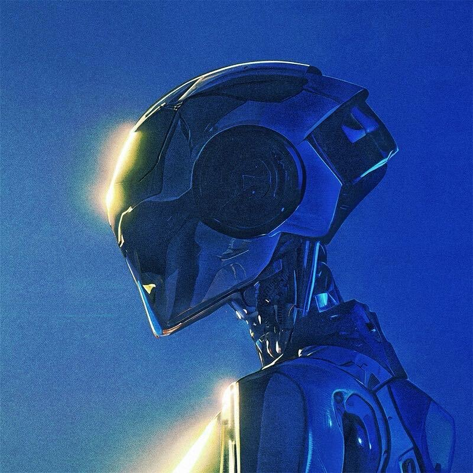

# restrained-hand-drawn-illustration

[English](#english) | [简体中文](#简体中文)

<a id="english"></a>

Create small, playful hand-drawn illustrations from a photo, image, or written prompt. The skill turns a large or realistic scene into a quiet visual vignette: tactile variable-width charcoal-like lines, intentional open contours, generous pale negative space, and only a trace of muted color.



**Xiaohongshu / RED:** @Tomorro Planet

## What it does

- Reinterprets photos and visual references without copying their exact composition, text, or characters.
- Generates compact, humorous scenes from prompts, rather than full-scale editorial or cinematic illustrations.
- Uses relaxed, pressure-sensitive black crayon/graphite linework with soft starts and lifted endings.
- Keeps shapes selectively open instead of sealing every contour into a clean icon.
- Delivers RGB JPG stills at the requested or source aspect ratio.
- Creates 6-second looping GIFs at 10 fps with linked character-and-scene motion, exported with a maximum 400 px longest edge.

## Visual principles

- Warm white or pale-cream ground with 55–80% negative space.
- A compact vignette, normally occupying 20–45% of the frame.
- One or two simplified subjects and one clear visual joke.
- Deep charcoal contours with visible, natural 2–3:1 line-weight variation.
- One muted accent color by default; no saturated color, gradients, realistic shading, or dense scenery.
- Deliberate contour gaps at overlaps and turns; avoid mechanical, closed, vector-like outlines.

## Installation

Clone or copy this repository into your Codex skills directory, naming the destination folder `restrained-hand-drawn-illustration`:

```text
<CODEX_HOME>/skills/restrained-hand-drawn-illustration/
```

If you downloaded the release archive, unzip it first and copy its contents into that location. Restart or refresh Codex so the skill is discovered.

## Example prompts

```text
Use $restrained-hand-drawn-illustration to create a 1:1 JPG of a woman pulling a suitcase to the right.
```

```text
Use $restrained-hand-drawn-illustration to reinterpret this photo as a small open-contour illustration, preserving the main action and the original aspect ratio.
```

```text
Use $restrained-hand-drawn-illustration to make a 3-second looping GIF: the climber reaches slightly upward, pauses, then settles back.
```

## Included files

```text
SKILL.md                         # Main workflow and quality gate
agents/openai.yaml               # Codex skill metadata
references/
├── style-system.md              # Fixed visual rules and palette recipes
├── line-profiles.md             # Crayon, gesture, and silhouette profiles
├── prompt-compiler.md           # Prompt-building guidance
└── motion-system.md             # Small-loop animation guidance
scripts/export_raster.py         # JPG and validated looping-GIF export helper
```

## GitHub description

> Create playful, restrained hand-drawn illustrations from photos or prompts, featuring natural open contours, tactile variable-width lines, pale backgrounds, sparse muted color, JPG delivery, and optional GIF motion.

---

<a id="简体中文"></a>

# restrained-hand-drawn-illustration（简体中文）

将照片、图片或文字提示转换为小巧、有趣的手绘插画。这个 skill 会把宏大或写实的场景提炼为安静的视觉小品：具有自然粗细变化的炭笔线条、有意识的开放轮廓、大面积浅色留白，以及极其克制的低饱和色彩。

**小红书：** @Tomorro Planet

## 功能

- 重新诠释照片与视觉参考，不复制原图的具体构图、文字或角色。
- 根据提示词生成紧凑、带一点幽默感的画面，而非大场景的编辑插画或电影感插画。
- 使用放松、带压力感的黑色蜡笔／石墨线条，保留自然的起笔与收笔。
- 有选择地留出轮廓缺口，避免把每个形体封闭成干净图标。
- 交付与原图或指定比例一致的 RGB JPG 静态图。
- 可生成 6 秒、10 fps 的循环 GIF；角色动作与受影响的场景元素会同步变化，最长边不超过 400 px。

## 视觉原则

- 暖白或浅奶油色背景，保留 55–80% 的负空间。
- 画面主体是小型 vignette，通常仅占画幅的 20–45%。
- 一到两个简化主体，一个清晰的视觉趣味点。
- 深炭黑轮廓具有可见、自然的 2–3:1 线条粗细变化。
- 默认只使用一种低饱和点缀色；不使用高饱和色、渐变、写实明暗或密集场景。
- 在重叠与转折处有意识地保留轮廓空隙，避免机械、封闭、矢量化的线条。

## 安装

将本仓库克隆或复制到 Codex 的 skills 目录，并将目标文件夹命名为 `restrained-hand-drawn-illustration`：

```text
<CODEX_HOME>/skills/restrained-hand-drawn-illustration/
```

如果下载的是压缩包，请先解压，再将其中内容放入以上位置。重启或刷新 Codex 后即可识别该 skill。

## 提示词示例

```text
使用 $restrained-hand-drawn-illustration 生成一张 1:1 JPG：一位女性向右拉着行李箱。
```

```text
使用 $restrained-hand-drawn-illustration 将这张照片重新诠释为小型开放轮廓插画，保留主要动作和原始画幅比例。
```

```text
使用 $restrained-hand-drawn-illustration 生成一个 6 秒循环 GIF：攀岩者向上伸手、稍作停顿，再回到初始姿势。
```

## 包含的文件

```text
SKILL.md                         # 主工作流与质量标准
agents/openai.yaml               # Codex skill 元数据
references/
├── style-system.md              # 固定视觉规则与配色方案
├── line-profiles.md             # 蜡笔、手势与剪影线条方案
├── prompt-compiler.md           # 提示词构建指南
└── motion-system.md             # 小循环动画指南
scripts/export_raster.py         # JPG 与循环 GIF 导出工具
```

## GitHub 描述

> 从照片或提示词生成克制、有趣的手绘插画：自然开放轮廓、具有粗细变化的触感线条、浅色背景、低饱和配色、JPG 交付与可选 GIF 动画。
